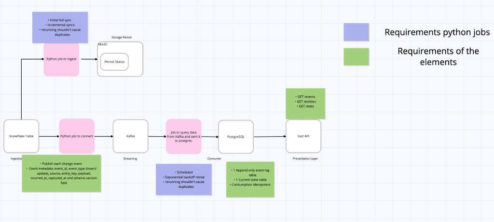

# Daisy Streams — End-to-End Streaming & Intelligence Platform

A production-grade, event-driven data streaming pipeline built to showcase portfolio capabilities in architecting, designing, and implementing an end-to-end data solution.

## Architecture Overview

### First Draft Architecture



### End-to-End Component Flow

1. **Ingestion & State Persistence**:
   - **Snowflake Table**: Source data (`TPCH_SF1.ORDERS`).
   - **Python Ingestion Job**: Performs initial full sync followed by incremental syncs without duplicate emissions.
   - **Storage Persistence (MinIO / S3)**: Persists sync status and watermark metadata across restarts.
   - **Producer Job**: Publishes validated change events with envelope metadata (`event_id`, `event_type`, `source`, `entity_key`, `payload`, `occurred_at`, `captured_at`, `schema_version`).
2. **Streaming Layer (Kafka / Redpanda)**:
   - Partitioned by `entity_key` for in-order change delivery.
3. **Consumer Layer**:
   - **Python Consumer Job**: Scheduled consumer with exponential backoff retries and duplicate-safe execution.
   - **PostgreSQL**: Dual-store maintaining an append-only event log table and an idempotent current-state table.
4. **Presentation Layer (FastAPI)**:
   - Exposes inspection endpoints: `GET /events`, `GET /entities`, `GET /stats`.

## Spec-Driven Development (SDD)

This project strictly adheres to **Spec-Driven Development (SDD)**: every architectural boundary, contract, and acceptance criterion is formally specified before implementation.

All specifications reside in the [`spec/`](./spec/) directory:

- [**`spec/spec-architecture-pipeline.md`**](./spec/spec-architecture-pipeline.md) — Master end-to-end system specification.
- [**`spec/spec-data-snowflake-adapter.md`**](./spec/spec-data-snowflake-adapter.md) — Snowflake adapter, bounded initial sync, watermark tracking, and restart state.
- [**`spec/spec-infrastructure-streaming-layer.md`**](./spec/spec-infrastructure-streaming-layer.md) — Broker topology, entity-keyed partitioning, and event envelope schemas.
- [**`spec/spec-tool-consumer-and-api.md`**](./spec/spec-tool-consumer-and-api.md) — PostgreSQL dual-table materialization, idempotent replay, DQ checks, and FastAPI inspection endpoints.
- [**`spec/spec-process-engineering-hygiene.md`**](./spec/spec-process-engineering-hygiene.md) — Unit testing, structured logging, configuration, and Docker Compose deployment.

## Data Source

The pipeline ingests from Snowflake's standard sample dataset:

```sql
SELECT * FROM SNOWFLAKE_SAMPLE_DATA.TPCH_SF1.ORDERS;
```

- **Entity Key**: `O_ORDERKEY`
- **Watermark Column**: `O_ORDERDATE` (paired with an update timestamp column for mutation capture)
- **Slice Scope**: 10,000–50,000 record bounded slice for initial synchronization, followed by persistent watermark-based incremental syncs.

## Core Capabilities & Guarantees

- **Incremental Sync**: Persistent high-watermark tracking surviving restarts; no re-emission of previously synced records.
- **Resilient Transport**: Validated Pydantic event envelopes, broker retry with backoff, and at-least-once delivery guarantees.
- **Idempotent Materialization**: Dual-table model (`event_log` + `current_state`) with verified convergence on topic replay from offset 0.
- **Data Quality Gates**: Automated validation (schema, business rules, deduplication) with quarantined DLQ routing (no silent drops).
- **Inspection API & Observability**: FastAPI service exposing `/events`, `/entities/{key}`, and `/stats` with end-to-end structured JSON log correlation.
